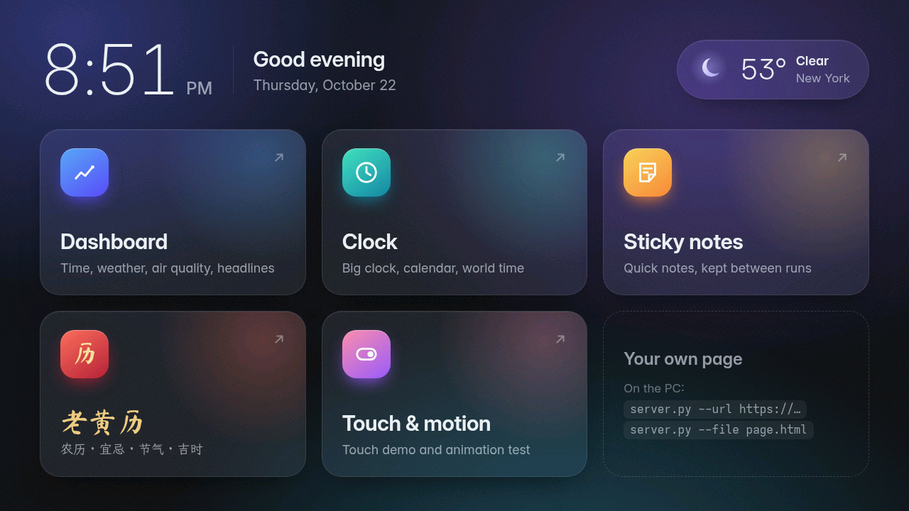
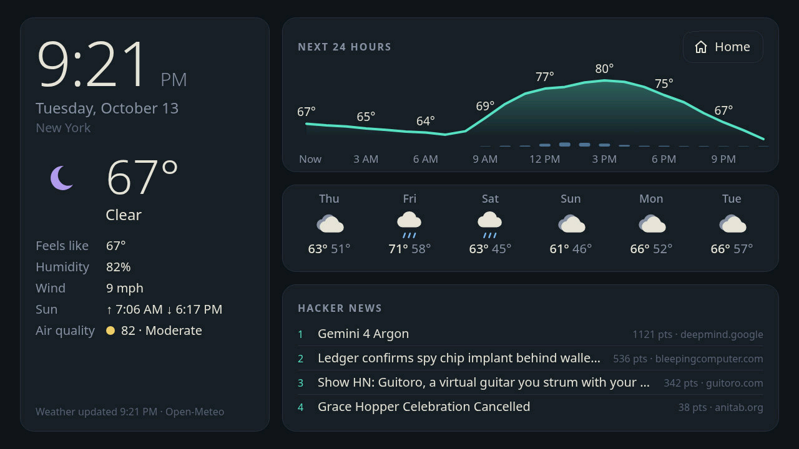
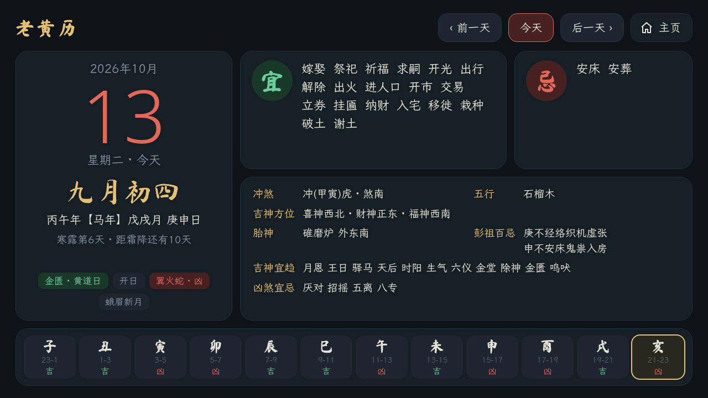
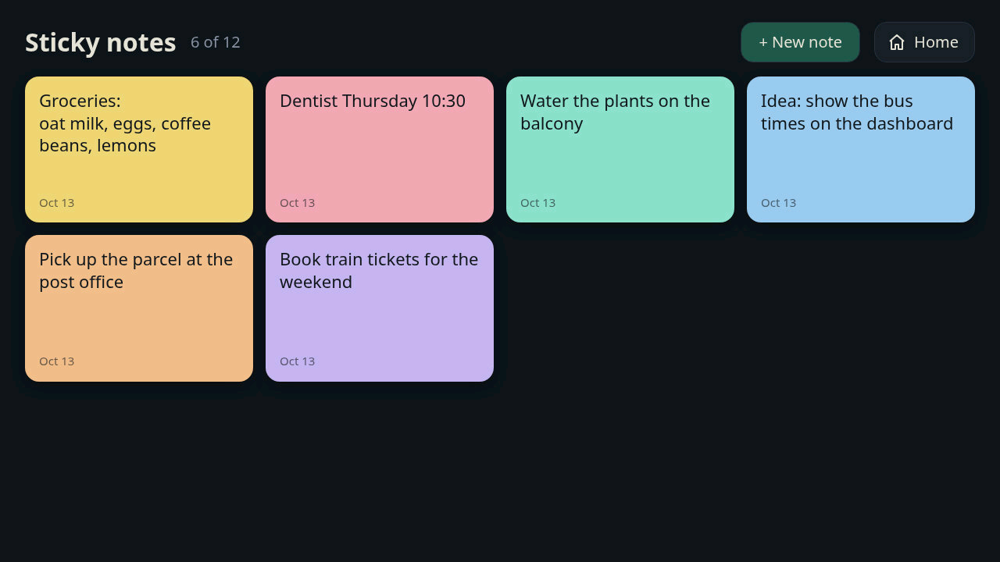
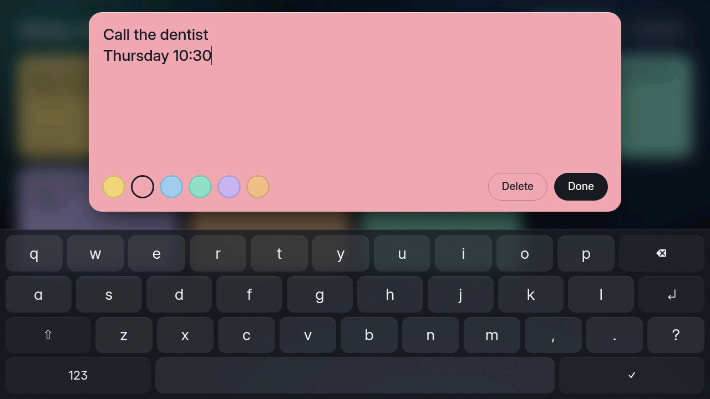

# Tab5 Web Display

Turn an [M5Stack Tab5](https://docs.m5stack.com/en/core/Tab5) into a touch screen for web pages. A small Python
server renders a page in headless Chromium on your PC, sends what changed to the Tab5 over WiFi, and passes your
taps and drags back to the page. Several ready-made apps are included, and you can show any URL or local HTML file.

Version 1.2.1 (firmware 1.2.0) · MIT licence



| | |
|---|---|
|  |  |
| **Dashboard**: time, weather, 24-hour chart, forecast, air quality, headlines | **老黄历 (Chinese almanac)**: lunar date, 宜忌, solar terms, auspicious hours |
|  |  |
| **Sticky notes**, kept between runs | ...with their own on-screen keyboard |

*All screenshots were read back from the Tab5's frame buffer.*

## Features

- **Any web page with real touch.** Taps, drags, sliders and canvas drawing work, because the page runs in a
  real browser on the PC.
- **Fast and light on the Tab5.**
  - **Only the 16×16 tiles that changed are sent.** An idle page with a ticking clock costs about 1.4 KB a second.
  - **The Tab5 barely works.** Its hardware JPEG decoder does the drawing, large changes straight into the
    frame buffer.
  - **Smooth.** Small animations run at up to 58 fps and full-screen ones at about 30; a finger-follow test shows
    a touch on screen in about 20–40 ms.
- **Sound.** What the page plays comes out of the Tab5's speaker or headphone jack, about a tenth of a second
  behind the PC, the same as the picture. Needs a Linux PC with PulseAudio or PipeWire.
- **Built-in apps that need no API keys:** a home launcher, a dashboard, a clock with calendar, sticky notes, a
  Chinese almanac (老黄历), and a touch demo with a motion test.
- **Setup on the device.** A settings panel opens on first start to pick a WiFi network with an on-screen keyboard.
  Later, swipe in from any screen edge to change WiFi, brightness or orientation.
- **No firewall changes.** The Tab5 listens and the PC connects out to it.

## What you need

- **An M5Stack Tab5.**
- **A PC on the same network** with Python 3.9 or newer. Tested on Linux; macOS and Windows should work but are
  untested.
- **Chromium or Google Chrome.** If neither is installed, Playwright can download its own Chromium.
- **For sound:** Linux with PulseAudio or PipeWire, and its `pactl` and `parec` tools (packages `pulseaudio-utils`
  or `libpulse`). Without them everything else works, silently.
- **To build the firmware:** [Arduino CLI](https://arduino.github.io/arduino-cli/).

## Quick start

### 1. Flash the firmware

```sh
arduino-cli core update-index --additional-urls https://static-cdn.m5stack.com/resource/arduino/package_m5stack_index.json
arduino-cli core install m5stack:esp32 --additional-urls https://static-cdn.m5stack.com/resource/arduino/package_m5stack_index.json
arduino-cli lib install M5Unified M5GFX lvgl@9.6.0
tools/build.sh upload /dev/ttyACM0            # your Tab5's serial port
```

The build script picks the board options. Tested with M5Stack core 3.3.9, M5Unified 0.2.25, M5GFX 0.2.33 and
LVGL 9.6.0.

**Check your chip revision.** Tab5 units use two ESP32-P4 chip revisions, and a build for the wrong one does not
boot. Run `esptool.py --port /dev/ttyACM0 chip_id`:
- **"revision v1.x":** use the default build.
- **v3.0 or later:** build with `CHIP=postv3 tools/build.sh upload`.

**Keep the firmware and the server at the same version.** Older and newer versions work together, but only with
the features both have (for example, sound needs firmware 1.1 or later). The server prints the Tab5's firmware
version when it connects, and a note when the two differ. Firmware from M5Burner can lag behind a new release
here for a while; build it yourself as above to get the newest, or use the server from the
[release](https://github.com/yejun/tab5-web-display/tags) that matches your firmware.

### 2. Connect the Tab5 to WiFi

On first start the Tab5 shows its settings panel. Pick your network and type the password on the on-screen
keyboard. The Tab5 then shows its address and the command to run on the PC.

### 3. Start the server on the PC

```sh
python3 -m venv .venv
.venv/bin/pip install -r requirements.txt     # Windows: .venv\Scripts\pip install -r requirements.txt
.venv/bin/python server/server.py             # the home launcher
```

**Finding the Tab5:** with the Tab5 plugged in by USB, the server asks it for its address. Otherwise pass
`--device <ip>`; the address is shown in the Tab5's settings.

**Browser:** if you have neither Chromium nor Chrome, run `.venv/bin/playwright install chromium` once.

## What to show

| command | shows |
|---|---|
| `server.py` | **Home**: a launcher for the apps below. Every app has a Home button. |
| `server.py --app dashboard` | time, current weather, 24-hour chart, 6-day forecast, air quality, Hacker News |
| `server.py --app clock` | big clock (tap it for seconds), month calendar, three world clocks |
| `server.py --app notes` | sticky notes with an on-screen keyboard |
| `server.py --app almanac` | 老黄历: lunar date, 干支, 宜/忌, 冲煞, solar terms, festivals, the twelve double-hours (in Chinese) |
| `server.py --app demo` | touch demo with sound: buttons, switches, music, sliders, finger paint that plays a tone (links to the motion test) |
| `server.py --app motion` | animation test with live frame rate |
| `server.py --url https://example.com` | any web page |
| `server.py --file my_page.html` | a local page, reloaded whenever it (or a file next to it) changes |

### App settings

- **Data sources (no API keys):** weather and air quality come from [Open-Meteo](https://open-meteo.com),
  headlines from the [Hacker News API](https://github.com/HackerNews/API).
- **Location:** New York unless you set one with `--city Berlin` or `--lat 52.52 --lon 13.40`. With `--city auto`
  it is guessed from your PC's IP address via [GeoJS](https://www.geojs.io).
- **Units:** follow the country (°F in the US). `--units metric|imperial` overrides that.
- **World clocks:** `--set zones=Europe/London,Asia/Tokyo,America/New_York`.
- **Any other `--set key=value`** reaches the page as `window.TAB5.key`, so your own pages can use it too.
- **Saved data:** notes and other browser storage live in a browser profile in `~/.local/share/tab5-web-display`.
  `--profile DIR` uses another one.

### Other options

| option | effect |
|---|---|
| `--device IP` | Tab5 address (default: asked over USB) |
| `--port PORT` | USB serial port (default: found automatically) |
| `--browser PATH` | Chromium or Chrome executable (default: found on `PATH`) |
| `--no-audio` | don't send the page's sound |
| `--power-save auto\|off` | Tab5 WiFi power save. `auto` (default): off only while you touch, the page animates or sound plays. `off`: always off, for the quickest response but shorter battery life |
| `--quality N` | JPEG quality once the page is still, default 95 (moving parts are sent rougher first) |
| `--max-fps N` | cap on updates per second, default 60 |
| `--show` | also open a visible browser window |
| `-v` | log every update |
| `--version` | print the version |

### Making your own pages

- **Size:** design for **1280×720** at a device pixel ratio of 1. The page is shown 1:1.
- **Edges:** keep buttons more than 40 px from the screen edges. A touch that starts there is held back for up to
  0.7 s while the Tab5 checks for the settings swipe.
- **Battery:** mostly static pages are kindest to it. Every change costs a WiFi transfer; changing once a minute
  is better than once a second.
- **Examples:** the built-in apps in `server/apps/` are plain HTML, CSS and JavaScript.

## Settings on the Tab5

**Opening the panel:** swipe in from any screen edge, or tap the screen when no page is shown. The panel also opens
by itself on first start, and whenever the saved network can't be joined.

**What's in it:**
- **WiFi:**
  - The scan list is sorted strongest first, with "Other network ..." for hidden networks.
  - A network is saved only once it connects. If a new one fails, the Tab5 goes back to the previous network.
- **Status:** the Tab5's address and the server command.
- **Display and sound:** brightness, volume, and flip 180°. All are remembered.

**While the panel is open,** the PC connection pauses. After **Done**, the PC reconnects within 2 s and redraws the
page.

## How it works

```
PC: server/server.py                                    Tab5: firmware/web_display
  Chromium (1280x720, touch)                              TCP server, port 8765
  screencast frame -> diff in 16x16 tiles   --- JPEG -->  hardware JPEG decode -> PPA rotate -> display
           -> changed rectangles as JPEG                  touch down / move / up
  touch events in the page                  <-- touch --
  Chromium's sound -> private sink -> parec --- PCM ---> jitter buffer -> speaker   (UDP, port 8765)
```

**On the PC:**
- **Frames:** Chromium streams a lossless frame whenever it repaints. The server compares it with what the Tab5
  shows and finds the changed 16×16 tiles.
- **Rectangles or strips:** small changes go out as tight rectangles. Large ones go out as full-height strips,
  already rotated into the panel's orientation, which the Tab5 decodes straight into its frame buffer. The server
  picks whichever the Tab5 draws faster.
- **Quality:** pieces are baseline JPEG. Still content goes out at quality 95 with full-resolution colour (4:4:4),
  so text stays sharp. During an animation, mostly-moving pieces go out rough: quality 70 (85 for small changes)
  with half-resolution colour (4:2:0), which the Tab5 draws about 40 % faster; other pieces at quality 88. Every
  tile sent below the top quality is sent again at quality 95 once it has stood still for 0.5 s, the oldest first
  and a tenth of the screen per update while something else still moves. So a page at rest is always at top
  quality.
- **Pipelining:** the next frame is prepared while earlier ones are still on their way. The Tab5 acknowledges each
  update once it is on screen. One update is in flight at a time, or two during an animation (not right after a
  touch, where delay matters more).

**On the Tab5:**
- **Drawing:** the ESP32-P4's hardware JPEG engine decodes a strip straight into the panel's portrait frame
  buffer. A rectangle is decoded to a buffer and then rotated into place by the PPA. Both use DMA, so the CPU only
  waits.
- **Touch:** touches go back to the PC as touch events.
- **WiFi power save** turns off for 10 s after a touch, while updates stream in and while sound plays, so replies
  arrive quickly. Otherwise it stays on. `--power-save off` keeps it off.

**Sound:**
- **On the PC:** Chromium plays into a private PulseAudio/PipeWire sink instead of the PC's speakers. The server
  records it as 48 kHz stereo and sends 7.5 ms per UDP datagram (1.5 Mbit/s), only while there is sound.
- **Why UDP:** over TCP, one lost packet holds back everything behind it until it is resent, which you would hear
  as a stutter. Over UDP a lost packet is 7.5 ms of silence.
- **On the Tab5:** a jitter buffer evens out WiFi's uneven delivery. It starts at 60 ms, grows after each hold-up
  and shrinks again while the network is calm. Playing a few frames in 480 more or fewer (at most 0.6 %, too
  little to hear) keeps it on target and follows the clock difference between PC and Tab5. The speaker is powered
  only while sound plays.

**Measured with `--app motion`:**

| scene | changed area | Tab5 fps | data |
|---|---|---|---|
| spinner | ~4% | 56–58 | ~300 KB/s |
| follow finger, while dragging | <1% | ~55 | ~110 KB/s |
| bouncing balls | 20–35% | 51–54 | ~1.2 MB/s |
| full-screen animation | 75–90% | 28–34 | ~1.9 MB/s |

**Details worth knowing:**
- **Colour range.** The P4's JPEG decoder expects "TV range" YCbCr (Y 16–235), but JPEG files use the full 0–255
  range. Decoded as-is, dark greys would be crushed to black, so the server converts to TV range before encoding.
- **Rendering noise.** Chromium's rasterisation jitters by a few levels between frames, so that is ignored. Once
  nothing has changed for 0.5 s, an exact cleanup pass sends whatever still differs.
- **PSRAM is the limit.** Copying a full screen into the frame buffer takes the PPA 45 ms and the CPU 28 ms, while
  the display controller reads the same memory 60 times a second. Decoding large changes straight into the frame
  buffer skips that copy, which more than doubled the full-screen frame rate.
- **Decoder quirks.** The Tab5's JPEG decoder garbles some images only 16 pixels wide and times out on 4:2:0
  images smaller than 48 pixels, so the server sends neither.
- **Why not H.264?** The P4 can only decode H.264 in software, at roughly 4 fps for 720p. A mostly static page
  gains nothing from video compression.

The wire format is described at the top of `firmware/web_display/web_display.ino`.

## Serial commands

USB serial at 115200 baud:

| command | does |
|---|---|
| `ip` | print the Tab5's IP address |
| `wifi <ssid> <password>` | join a network |
| `panel` | open the settings |
| `rot` | flip the screen 180° |
| `beep` | play a test tone and print the speaker's state |
| `forget` | erase all saved settings and restart |
| `S` | statistics since the last `S`, including sound |
| `T <x> <y>`, `drag <x0> <y0> <x1> <y1> [ms]` | scripted touches, for testing without a finger |
| `unconfigured` | behave like a first start until the next reboot |
| `F` | dump the frame buffer; `tools/shot.py out.png` saves it as a PNG |

## Troubleshooting

- **"No Tab5 found on USB":** pass `--device <ip>`. The address is in the Tab5's settings (swipe in from an
  edge).
- **The Tab5 says "Waiting for the PC" but nothing appears:**
  - The PC and the Tab5 must be able to reach each other: same network, or routed.
  - Check that the server prints `showing on Tab5`.
- **The server says the firmware is older or newer than the server:** update the older one. See
  [Flash the firmware](#1-flash-the-firmware).
- **The screen stays black after flashing:** the build doesn't match your chip revision. See
  [Flash the firmware](#1-flash-the-firmware).
- **No sound:**
  - The server prints `with sound` once connected. If it says the firmware is older than 1.1, flash the new one.
  - `sound: off (needs PulseAudio or PipeWire ...)`: install `pactl` and `parec`. Sound works on Linux only.
  - Check the volume in the Tab5's settings.
  - Many sites start sound only after a tap.
- **Chromium not found:** run `.venv/bin/playwright install chromium`, or pass `--browser /path/to/chrome`.

## Licence

[MIT](LICENSE) © 2026 Yejun Yang

The almanac includes these third-party components:
- [lunar-javascript](https://github.com/6tail/lunar-javascript) by 6tail (MIT): unmodified, in `server/apps/vendor/`.
- [LXGW WenKai](https://github.com/lxgw/LxgwWenKai) and [Ma Shan Zheng](https://github.com/google/fonts/tree/main/ofl/mashanzheng)
  (SIL Open Font License 1.1): cut down to the characters the almanac uses, in `server/apps/fonts/`. Because they
  are bundled, no Chinese font is needed on the PC.
