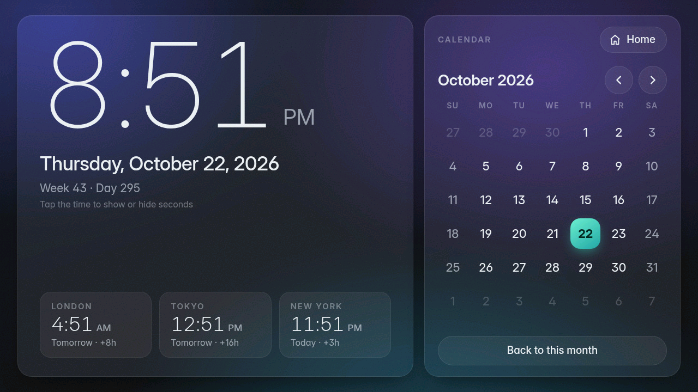
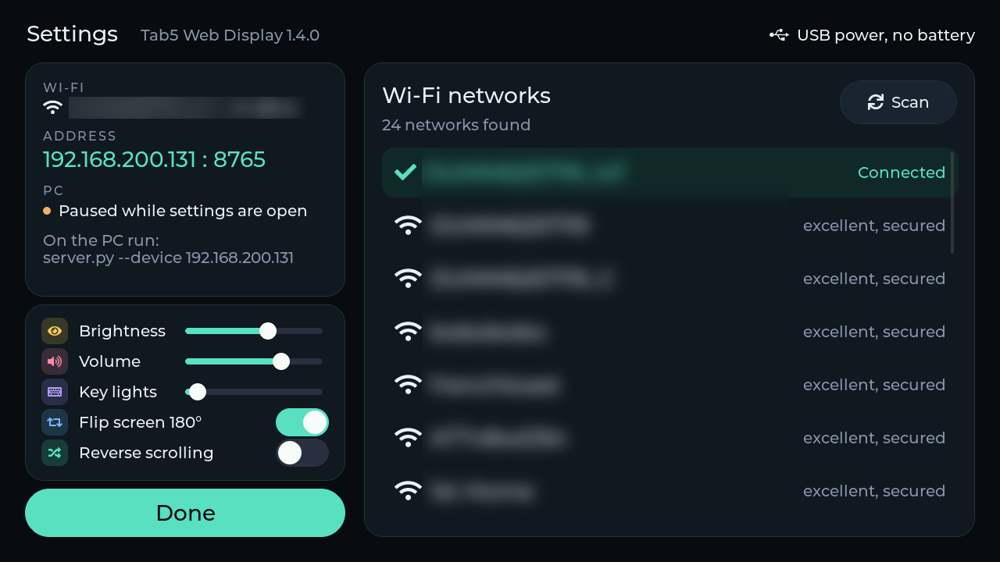

# Tab5 Web Display

Turn an [M5Stack Tab5](https://docs.m5stack.com/en/core/Tab5) into a touch screen for web pages. A small Python
server renders a page in headless Chromium on your PC, sends what changed to the Tab5 over WiFi, and passes your
touches back to the page, along with keys from M5Stack's Tab5 Keyboard or a USB keyboard, and a USB mouse.
Several ready-made apps are included, and you can show any URL, local HTML file or video.

Version 1.5.0 · MIT licence


| | |
|---|---|
|  |  |
| **Dashboard**: time, weather, 24-hour chart, forecast, air quality, the sun's path, headlines | **Clock**: big clock, month calendar, world clocks |
|  |  |
| **老黄历 (Chinese almanac)**: lunar date, 宜忌, solar terms, auspicious hours | **Sticky notes**, kept between runs |
|  |  |
| ...with their own on-screen keyboard | **Settings** on the Tab5: WiFi, brightness, volume, orientation |

*All screenshots were read back from the Tab5's frame buffer (WiFi network names blurred).*

## Features

- **Any web page with real touch.** Taps, drags, sliders and canvas drawing work, because the page runs in a
  real browser on the PC. Every finger counts, so pages pinch-zoom and scroll as on a phone.
- **Tabs and history.** A link that opens a new tab shows it. Swipe in from the side edges to switch tabs, up from
  the bottom to close one; three fingers swiped sideways go back and forward.
- **Keyboard.** With [M5Stack's Tab5 Keyboard](https://docs.m5stack.com/en/tab5/Tab5_Keyboard) fitted, you type
  into the page; it also controls videos and types the WiFi password. Its two lights show the connection and the
  Sym / Aa keys.
- **USB keyboard and mouse.** Plug them into the Tab5's USB-A port (a wireless receiver works too). The mouse
  hovers, clicks, double-clicks and scrolls in the page, with the pointer drawn by the Tab5 itself, so it moves
  without waiting for the PC.
- **Fast and light on the Tab5.**
  - **Only the 16×16 tiles that changed are sent.** An idle page with a ticking clock costs about 1.4 KB a second.
  - **The Tab5 barely works.** Its hardware JPEG decoder does the drawing, large changes straight into the
    frame buffer.
  - **Smooth.** Small animations run at up to 58 fps and full-screen ones at about 30; a finger-follow test shows
    a touch on screen in about 20–40 ms.
- **Sound.** What the page plays comes out of the Tab5's speaker or headphone jack, about a tenth of a second
  behind the PC, the same as the picture. Needs a Linux PC with PulseAudio or PipeWire.
- **Videos.** `--file clip.mp4` plays any video ffmpeg can decode, in a loop and with sound, at up to 30 fps.
  Tap to pause, drag sideways to seek. Videos in web pages (YouTube) play at up to about 26 fps.
- **Built-in apps that need no API keys:** a home launcher, a dashboard, a clock with calendar, sticky notes, a
  Chinese almanac (老黄历), and a touch demo with a motion test. They share one look: frosted-glass cards on a sky
  whose colours follow the weather or the time of day.
- **Setup on the device.** A settings panel opens on first start to pick a WiFi network with an on-screen keyboard.
  Later, swipe down from the top edge to change WiFi, brightness or orientation, or to check the battery.
- **No firewall changes.** The Tab5 listens and the PC connects out to it.

## What you need

- **An M5Stack Tab5.** Optionally M5Stack's Tab5 Keyboard.
- **A PC on the same network** with Python 3.9 or newer. Tested on Linux; macOS and Windows should work but are
  untested.
- **Chromium, Google Chrome or Microsoft Edge.** The server finds them on the `PATH` or in their usual install
  folders on Windows and macOS. If none is installed, Playwright can download its own Chromium.
- **For sound:** Linux with PulseAudio or PipeWire, and its `pactl` and `parec` tools (packages `pulseaudio-utils`
  or `libpulse`). Without them everything else works, silently.
- **Optional, for a lighter server:** `pip install numba`, or `pip install numba PyTurboJPEG` for the fastest
  encoding (PyTurboJPEG also needs the libjpeg-turbo library: `libjpeg-turbo` on Arch, `libturbojpeg0` on
  Debian/Ubuntu, `brew install jpeg-turbo` on macOS, the libjpeg-turbo installer on Windows). The server picks the
  fastest one installed and prints which.
- **For videos:** [ffmpeg](https://ffmpeg.org) (with `ffprobe`) on the PATH. Video sound needs no PulseAudio.
- **To build the firmware:** [Arduino CLI](https://arduino.github.io/arduino-cli/).

## Quick start

### 1. Flash the firmware

```sh
arduino-cli core update-index --additional-urls https://static-cdn.m5stack.com/resource/arduino/package_m5stack_index.json
arduino-cli core install m5stack:esp32 --additional-urls https://static-cdn.m5stack.com/resource/arduino/package_m5stack_index.json
arduino-cli lib install M5Unified M5GFX lvgl@9.6.0
tools/build.sh upload /dev/ttyACM0            # your Tab5's serial port
```

The build script picks the board options. Tested with M5Stack core 3.3.9, M5Unified 0.2.25, M5GFX 0.2.33 and
LVGL 9.6.0.

**Check your chip revision.** Tab5 units use two ESP32-P4 chip revisions, and a build for the wrong one does not
boot. Run `esptool.py --port /dev/ttyACM0 chip_id`:
- **"revision v1.x":** use the default build.
- **v3.0 or later:** build with `CHIP=postv3 tools/build.sh upload`.

**Keep the firmware and the server at the same version.** Older and newer versions work together, but only with
the features both have (for example, sound needs firmware 1.1 or later). The server prints the Tab5's firmware
version when it connects, and a note when the two differ. Firmware from M5Burner can lag behind a new release
here for a while; build it yourself as above to get the newest, or use the server from the
[release](https://github.com/yejun/tab5-web-display/tags) that matches your firmware.

### 2. Connect the Tab5 to WiFi

On first start the Tab5 shows its settings panel. Pick your network and type the password on the on-screen
keyboard. The Tab5 then shows its address and the command to run on the PC.

### 3. Start the server on the PC

```sh
python3 -m venv .venv
.venv/bin/pip install -r requirements.txt     # Windows: .venv\Scripts\pip install -r requirements.txt
.venv/bin/python server/server.py             # the home launcher
```

**Finding the Tab5:** with the Tab5 plugged in by USB, the server asks it for its address. Otherwise pass
`--device <ip>`; the address is shown in the Tab5's settings.

**Browser:** if you have neither Chromium nor Chrome, run `.venv/bin/playwright install chromium` once.

## What to show

| command | shows |
|---|---|
| `server.py` | **Home**: a launcher for the apps below. Every app has a Home button. |
| `server.py --app dashboard` | time, current weather, 24-hour chart, 6-day forecast, air quality, Hacker News |
| `server.py --app clock` | big clock (tap it for seconds), month calendar, three world clocks |
| `server.py --app notes` | sticky notes with an on-screen keyboard |
| `server.py --app almanac` | 老黄历: lunar date, 干支, 宜/忌, 冲煞, solar terms, festivals, the twelve double-hours (in Chinese) |
| `server.py --app demo` | touch demo with sound: buttons, switches, music, sliders, finger paint that plays a tone (links to the motion test) |
| `server.py --app motion` | animation test with live frame rate |
| `server.py --url https://example.com` | any web page |
| `server.py --file my_page.html` | a local page, reloaded whenever it (or a file next to it) changes |
| `server.py --file clip.mp4` | a video, in a loop, with sound (see below) |

### Videos

Any file ffmpeg can play as a video works: MP4, MKV, WebM, MOV, animated GIF, and so on. It is scaled to fit the
screen and plays in a loop.

- **Tap** to pause or resume (or **Space** on the keyboard).
- **Drag sideways** to seek: across the whole screen is 2 minutes (or the whole video, if shorter). While the bar
  shows, drag on the bar itself to put the position under your finger, or tap it to jump there. A seek stops at
  the start and the end; letting go at the end plays the last moment, then the video starts over.
- **Keyboard:** the left and right arrows seek 5 s, and keep going while held (6× further with Aa); 0–9 jump to
  0–90 % of the way through.
- **The bar** at the bottom shows the time, the length and the file name. It stays while paused or seeking, and
  fades out 3 seconds after a touch while playing.
- **Smooth playback** (firmware 1.3.2): the Tab5 keeps a few frames in hand and shows them at an even pace, so
  WiFi's uneven delivery doesn't make the picture stutter. For a second after a touch it shows frames at once.
- **Picture quality** adapts to what WiFi carries, so that every frame arrives in time: detailed footage plays at
  the full 30 fps at about quality 45–50. A paused picture sharpens to full quality.

### App settings

- **Data sources (no API keys):** weather and air quality come from [Open-Meteo](https://open-meteo.com),
  headlines from the [Hacker News API](https://github.com/HackerNews/API).
- **Location:** New York unless you set one with `--city Berlin` or `--lat 52.52 --lon 13.40`. With `--city auto`
  it is guessed from your PC's IP address via [GeoJS](https://www.geojs.io).
- **Units:** follow the country (°F in the US). `--units metric|imperial` overrides that.
- **World clocks:** `--set zones=Europe/London,Asia/Tokyo,America/New_York`.
- **Any other `--set key=value`** reaches the page as `window.TAB5.key`, so your own pages can use it too.
- **Saved data:** notes and other browser storage live in a browser profile in `~/.local/share/tab5-web-display`.
  `--profile DIR` uses another one.

### Other options

| option | effect |
|---|---|
| `--device IP` | Tab5 address (default: asked over USB) |
| `--port PORT` | USB serial port (default: found automatically) |
| `--browser PATH` | Chromium, Chrome or Edge executable (default: found on the `PATH` or in the usual install folders) |
| `--no-audio` | don't send the page's sound |
| `--power-save auto\|off` | Tab5 WiFi power save. `auto` (default): off only while you touch, the page animates or sound plays. `off`: always off, for the quickest response but shorter battery life |
| `--quality N` | JPEG quality once the page is still, default 95 (moving parts are sent rougher first) |
| `--max-fps N` | cap on updates per second, default 60 |
| `--encoder E` | JPEG encoder: `auto` (default, the fastest installed), `pillow`, `numba` or `turbo+numba` |
| `--lanes N` | TCP connections to spread the stream over (firmware 1.3 or later): `2` (default) or `1`, a single connection |
| `--no-pacing` | videos: show frames as they arrive, without the Tab5's playout buffer |
| `--listen [HOST:]PORT` | for the Tab5's remote mode: it connects to the PC, through a tunnel of your own; see below |
| `--pair CODE`, `--devices`, `--unpair CODE` | allow a Tab5 asking to pair, list the paired ones, forget one (remote mode) |
| `--show` | also open a visible browser window |
| `-v` | log every update |
| `--version` | print the version |

### Away from home: `--listen` and remote mode

Normally the server connects to the Tab5 on your network. In **remote mode** it's the other way round: the Tab5
connects out to the PC, through a tunnel or reverse proxy that you set up (a
[Cloudflare Tunnel](https://developers.cloudflare.com/tunnel/), ngrok, Tailscale Funnel, nginx, ...), so it works
on any WiFi that reaches it.

1. On the PC: `server.py --listen 8790`, and point your tunnel at `http://127.0.0.1:8790` (`--listen 0.0.0.0:8790`
   takes connections from other machines too).
2. On the Tab5: settings, turn on **Remote** and enter the tunnel's address, which must start with `https://`
   (or on the serial console: `tunnel https://tab5.example.com`). It is kept across restarts.
3. The first time, pair the Tab5 with the PC: the Tab5 shows a six-digit code, and the server asks on its terminal
   `a Tab5 asks to pair, with code 482 913. Pair it? [y/N]`. Answer `y` if the codes match.

**Pairing:** each Tab5 has a random ID, made once and sent with every connection over https. A Tab5 the PC doesn't
know gets nothing until it is allowed, and a refused one asks again a minute later. Several Tab5s can be paired.
- Without a terminal (the server running as a service), allow it from another one: `server.py --pair 482913`.
- A Tab5 plugged in by USB when the server starts is paired at once.
- `server.py --devices` lists the paired Tab5s; `server.py --unpair 482913` forgets one. They are kept in
  `~/.local/share/tab5-web-display-devices.json` (hashes of their IDs).
- Erasing the Tab5's settings (`forget`) gives it a new ID, so it pairs again.

**While remote mode is on** the Tab5 takes no connections from the local network, so on a public network nobody
there can take its screen or read what is typed on it. Turn Remote off at home to use the local network again; the
address is kept. (On the local network there is no pairing.)

- **Connection:** a WebSocket over HTTPS, with the server's certificate checked.
- **Speed:** measured through Cloudflare's network, a tap's response took 132 ms (124 ms on the local network) and
  a heavy video played at 25-27 fps (30). It is one connection, without lanes: TLS needs the Tab5's internal memory.
- **Sound** goes along inside the same connection.
- Check your tunnel provider's terms before streaming video through it for long.

### Making your own pages

- **Size:** design for **1280×720** at a device pixel ratio of 1. The page is shown 1:1.
- **Edges:** keep buttons more than 40 px from the screen edges. A touch that starts there is held back for up to
  0.7 s while the Tab5 checks for a swipe (settings, tabs).
- **Touch and keys** arrive as normal touch and keyboard events, with every finger; Chromium's own pinch zoom
  applies unless the page turns it off (`touch-action`, or a viewport meta tag with `user-scalable=no`).
- **Battery:** mostly static pages are kindest to it. Every change costs a WiFi transfer; changing once a minute
  is better than once a second.
- **Examples:** the built-in apps in `server/apps/` are plain HTML, CSS and JavaScript.

## Settings on the Tab5

**Opening the panel:** swipe down from the top edge, or tap the screen when no page is shown. (With a video, or a
server older than 1.3, any edge works.) On a USB keyboard, Scroll Lock opens and closes it. The panel also opens by
itself on first start, and whenever the saved network can't be joined.

**Tabs and history (pages):** a link that opens a new tab shows it at once. Swipe in from the right edge for the
next tab, from the left edge for the one before, and up from the bottom edge to close the tab. Three fingers
swiped left go back, swiped right go forward (Alt+arrows on the keyboard too). A note at the top says where you
are, e.g. "2 / 3 · Page title".

**What's in it:**
- **WiFi:**
  - The scan list is sorted strongest first, with "Other network ..." for hidden networks.
  - A network is saved only once it connects. If a new one fails, the Tab5 goes back to the previous network.
- **Status:** the Tab5's address and the server command; with **Remote** on, the remote server's address (tap it
  to change it) and the pairing code (see `--listen`).
- **Battery** (top right): charge level, whether it is charging, voltage and current, and a rough time to full
  or time left.
- **Display and sound:** brightness, volume, keyboard lights (left end: off), flip 180°, and reverse scrolling
  (a USB mouse's wheel turned around, as "natural" scrolling on a touchpad). All are remembered. Until you first
  use the flip switch, the Tab5 starts flipped when the keyboard is fitted, since that is upright in it; the switch
  shows which way is in use.
- **With a USB mouse** the panel shows the pointer, and clicks work like taps.

**While the panel is open,** the PC connection pauses. After **Done**, the PC reconnects within 2 s and redraws the
page.

## Keyboard

M5Stack's [Tab5 Keyboard](https://docs.m5stack.com/en/tab5/Tab5_Keyboard) plugs into the Tab5's Ext.Port1 (attach
it with the Tab5 off: the pin header isn't made for plugging in while powered). The Tab5 finds it at start, or
within 2 s while running; without one nothing changes.

- **In a page:** letters, digits, symbols, Enter, Backspace, Tab, Esc, arrows and Ctrl/Alt shortcuts (Ctrl+A,
  Ctrl+C, ...). A held key repeats.
  - **Aa** gives capitals, and acts as Shift on keys that don't type: Aa+arrows selects text, Aa+Tab goes back.
  - **Sym** gives the second symbol printed on a key (`.` gives `,`), and the keys the keyboard lacks: Sym+← / →
    Home / End, Sym+↑ / ↓ Page Up / Page Down, Sym+Backspace Delete.
  - **Alt+← / →** go back and forward.
- **With a video:** Space, the arrows and 0–9 (see [Videos](#videos)).
- **In the settings:** type the WiFi name and password; Enter connects, Tab switches field, Esc closes.
- **The lights:** left: white while Aa is held, amber while Sym is. Right: green with a PC connected, dim blue with
  WiFi but no PC, amber without WiFi, blinking red below 10 % battery. Set their brightness, or turn them off, in
  the settings.

## USB keyboard and mouse

Plug a keyboard, a mouse, or both (through a hub, or one wireless receiver for both) into the Tab5's USB-A port.
The Tab5 powers the port from the start, which costs a little battery.

- **Keyboard:** everything the Tab5 Keyboard does, plus F1–F12, Insert and the number pad. Caps Lock works and
  lights up on the keyboard; Scroll Lock opens the settings. The server adds the browser shortcuts headless Chromium
  lacks: **F5** or **Ctrl+R** reloads, **Ctrl+Tab** / **Ctrl+Shift+Tab** switch tabs, **Ctrl+W** closes one,
  **Alt+← / →** go back and forward.
- **Mouse:** with server 1.4, the page gets real mouse events: hover (links underline, tooltips appear), left,
  right and middle click, double click, Ctrl/Shift/Alt-click and the wheel, horizontal too. The back and forward
  side buttons move through the history. The wheel's direction can be reversed in the settings.
- **The pointer** is an arrow the Tab5 draws itself, so it follows the mouse at once, without a round trip to the
  PC. Page updates under it get the arrow blended in before they reach the screen, so it doesn't flicker over
  animations or videos. It hides when you touch the screen.
- **Videos, and servers older than 1.4:** the left button acts as a finger (tap to pause, drag to seek).
- **Show-off detail:** the arrow is blended with the ESP32-P4's PIE SIMD instructions, 8 pixels per instruction in
  a hardware loop: 7.7 µs instead of 86 µs in plain C (measured on a v1.x chip). The firmware checks it against the
  C version at every start and uses C if they ever differ; the serial `simd` command repeats the check.

## How it works

```
PC: server/server.py                                    Tab5: firmware/web_display
  Chromium (1280x720, touch)                              TCP server, port 8765 (+ 8766, lanes)
  screencast frame -> diff in 16x16 tiles   --- JPEG -->  hardware JPEG decode -> PPA rotate -> display
           -> changed rectangles as JPEG                  touch (every finger), keys, swipes
  touch / key events, tabs, back / forward  <-- events --
  Chromium's sound -> private sink -> parec --- PCM ---> jitter buffer -> speaker   (UDP, port 8765)
```

**On the PC:**
- **Frames:** Chromium streams a lossless frame whenever it repaints. Each is decoded in the background while the
  previous one is encoded and sent (a detailed frame takes 20–40 ms to decode). The server compares it with what
  the Tab5 shows and finds the changed 16×16 tiles.
- **Rectangles or strips:** small changes go out as tight rectangles. Large ones go out as full-height strips,
  already rotated into the panel's orientation, which the Tab5 decodes straight into its frame buffer. The server
  picks whichever the Tab5 draws faster.
- **Quality:** pieces are baseline JPEG. Still content goes out at quality 95 with full-resolution colour (4:4:4),
  so text stays sharp. During an animation, mostly-moving pieces go out rough, with half-resolution colour (4:2:0),
  which the Tab5 draws about 40 % faster: quality 85 for small changes; for large ones (a video, scrolling) a
  quality between 35 and 85 that adapts so each frame fits the measured WiFi rate divided by the content's frame
  rate. It only goes down when the server actually waits for the Tab5; other pieces at quality 88. Every
  tile sent below the top quality is sent again at quality 95 once it has stood still for 0.5 s, the oldest first
  and a tenth of the screen per update while something else still moves. So a page at rest is always at top
  quality.
- **Pipelining:** the next frame is prepared while earlier ones are still on their way. The Tab5 acknowledges each
  update once it is on screen. One update is in flight at a time, or two during an animation (not right after a
  touch, where delay matters more).

**On the Tab5:**
- **Drawing:** the ESP32-P4's hardware JPEG engine decodes a strip straight into the panel's portrait frame
  buffer. A rectangle is decoded to a buffer and then rotated into place by the PPA. Both use DMA, so the CPU only
  waits.
- **Touch:** touches go back to the PC as touch events, every finger (up to 5), so pages pinch-zoom and scroll
  as on a phone.
- **Keyboard:** the keyboard's controller reports each key going down and up over I2C; the Tab5 applies the Sym
  and Aa layers and sends USB HID key codes, which the server turns into browser key events (and repeats while
  held). Edge and three-finger swipes are recognised on the Tab5 and sent as gestures; the server switches tabs
  and moves through the history with them.
- **WiFi power save** turns off for 10 s after a touch, while updates stream in and while sound plays, so replies
  arrive quickly. Otherwise it stays on. `--power-save off` keeps it off.

**Sound:**
- **On the PC:** Chromium plays into a private PulseAudio/PipeWire sink instead of the PC's speakers. The server
  records it as 48 kHz stereo and sends 7.5 ms per UDP datagram (1.5 Mbit/s), only while there is sound.
- **Why UDP:** over TCP, one lost packet holds back everything behind it until it is resent, which you would hear
  as a stutter. Over UDP a lost packet is 7.5 ms of silence.
- **On the Tab5:** a jitter buffer evens out WiFi's uneven delivery. It starts at 60 ms, grows after each hold-up
  and shrinks again while the network is calm. Playing a few frames in 480 more or fewer (at most 0.6 %, too
  little to hear) keeps it on target and follows the clock difference between PC and Tab5. The speaker is powered
  only while sound plays.

**Videos:** two ffmpeg processes decode the picture (scaled and letterboxed to 1280×720, at most 30 fps) and the
sound (48 kHz stereo). The server keeps the clock for pause, seek and loop, and hands each frame out when it is
due: frames go through the same tile pipeline as a page's, and sound goes out as above, without PulseAudio. A
video changes the whole screen every frame, so WiFi (about 2.5–3 MB/s) sets the pace. The quality of moving frames
adapts to fit the measured link rate divided by the frame rate, between 35 and 85 (detailed footage measured
141 KB per frame at quality 70 and 89 KB at 40, which still looks fine at the panel's 290 ppi). Sound is
a few tens of milliseconds behind the picture at most.

**Playout buffer (firmware 1.3.2):** frames left the PC evenly but WiFi delivered them in bunches (5 ms apart, then
60), and drawn on arrival a 30 fps video showed a gap of over 50 ms every eighth frame or so. Now the server hands
video frames out 100 ms early, each with its due time, and the Tab5 holds each one until then (it stays compressed
in the lane buffers) and shows it 60 ms after the clock, as the sound. The Tab5 ties its clock to the PC's by the
fastest deliveries it sees, and tells the server in each "shown" how late a frame began; the quality adapts to
keep that rare. For a second after a touch or a key it draws frames at once. Measured on detailed footage: 29.8 fps
instead of 27.9, gaps over 50 ms 3 % instead of 13 %, the 95th percentile gap 45 ms instead of 85, at the same
quality. It needs the lanes (one connection's 64 KB window can't hold frames ahead); `--no-pacing` turns it off.

**Encoders:** a frame's changed pieces are converted to TV-range YCbCr and encoded as JPEG in a worker thread.

| encoder | needs | video strip / text page (encode) | server CPU, video / motion test |
|---|---|---|---|
| `pillow` | nothing extra | 13.3 / 8.2 ms | 48 % / 80 % of a core |
| `numba` | `numba` | 7.2 / 6.7 ms | 35 % / 75 % |
| `turbo+numba` | `numba`, `PyTurboJPEG`, libjpeg-turbo | 4.0 / 5.7 ms | 27 % / 71 % |

The Numba kernel reads a strip in its rotated order directly, and its colour conversion is exact (Pillow's double
rounding shifts each channel by up to a level). Frame rates stay the same: the Tab5 and WiFi set them. On pages
most of the server's time goes into decoding Chromium's lossless PNG frames (about 9 ms each).

**Lanes (firmware 1.3):** one TCP connection to the Tab5 carries at most about 3 MB/s, because its 64 KB receive
window is fixed in the precompiled network stack (Linux reported the connection held back by it half the time).
So after the hello the stream moves to two connections, in 16 KB chunks dealt alternately; the Tab5 reassembles
them in order. Measured on WiFi 6: one connection 3.1 MB/s, two 4.4, three 4.8, the radio's ceiling 5.0–5.3.
- **Why two:** the router delivers each connection's 64 KB in bursts, into the network stack's buffers in internal
  RAM, before anything can move it on. Over four minutes of video the lowest free internal RAM was 103 KB with one
  connection, 100 KB with two and 33–56 KB with three, which carried only 3 % more than two.
- **Each lane is drained by its own task** into a 1 MB buffer in PSRAM. Read in turn instead, every lane's window
  filled while a frame decoded, in the network stack's buffers in internal RAM, which ran down to 140 bytes.
  Drained at once, the low point stays near 100 KB, as with a single connection.
- **Nudges.** With the stream on the lanes, the main connection only carries the Tab5's small events (touches,
  "shown"), and a lost one waited for lwIP's retransmission timer, a second or more, stalling the stream several
  times a minute. While updates or touches come and go, the Tab5 now follows each event with a tiny one within
  20 ms, so a loss is noticed and resent at once.
- **Fallback.** Older firmware, older servers, or a lane that can't be set up: one connection, as before. Any lane
  that fails ends the session, and the server reconnects.
- **Lost packets at the end of a burst.** With nothing after it, TCP would wait for its retransmission timer while
  the Tab5 waits for that chunk. If a "shown" is 150 ms overdue, the server sends one more update, whose data
  reveals the gap.
- **What it brings:** four minutes of detailed video: 2.83 MB/s instead of 2.50, which the adaptive quality turns
  into quality 49 instead of 41 at the same 27 fps, with no stall over 250 ms. More of the link's capacity is held
  back by the two updates in flight: each round trip (send, decode, "shown") moves two.

**Measured with `--app motion`:**

| scene | changed area | Tab5 fps | data |
|---|---|---|---|
| spinner | ~4% | 56–58 | ~300 KB/s |
| follow finger, while dragging | <1% | ~55 | ~110 KB/s |
| bouncing balls | 20–35% | 51–54 | ~1.2 MB/s |
| full-screen animation | 75–90% | 28–34 | ~1.9 MB/s |
| video, detailed (Big Buck Bunny 720p) | 100% | ~30, evenly (quality ~45–50) | ~2.7 MB/s |
| video, simple | ~8% | 30 (quality 85) | ~100 KB/s |

**Details worth knowing:**
- **Colour range.** The P4's JPEG decoder expects "TV range" YCbCr (Y 16–235), but JPEG files use the full 0–255
  range. Decoded as-is, dark greys would be crushed to black, so the server converts to TV range before encoding.
- **Rendering noise.** Chromium's rasterisation jitters by a few levels between frames, so that is ignored. Once
  nothing has changed for 0.5 s, an exact cleanup pass sends whatever still differs.
- **PSRAM is the limit.** Copying a full screen into the frame buffer takes the PPA 45 ms and the CPU 28 ms, while
  the display controller reads the same memory 60 times a second. Decoding large changes straight into the frame
  buffer skips that copy, which more than doubled the full-screen frame rate.
- **Decoder quirks.** The Tab5's JPEG decoder garbles some images only 16 pixels wide and times out on 4:2:0
  images smaller than 48 pixels, so the server sends neither.
- **Why not H.264?** The P4 can only decode H.264 in software, at roughly 4 fps for 720p. A mostly static page
  gains nothing from video compression.

The wire format is described at the top of `firmware/web_display/web_display.ino`.

## Serial commands

USB serial at 115200 baud:

| command | does |
|---|---|
| `ip` | print the Tab5's IP address |
| `wifi <ssid> <password>` | join a network |
| `tunnel <https address>`, `tunnel on`, `tunnel off` | remote mode: connect out to the PC through a tunnel (see `--listen`); `tunnel` shows it and the pairing code |
| `panel` | open the settings |
| `rot` | flip the screen 180° |
| `rot auto` | forget the saved rotation: from the next start it follows the keyboard |
| `beep` | play a test tone and print the speaker's state |
| `forget` | erase all saved settings and restart |
| `S` | statistics since the last `S`, including frame pacing, sound, battery, keyboard, USB devices, lanes and memory |
| `wifiinfo` | the WiFi standard in use (WiFi 4 or 6), channel and signal |
| `T <x> <y>`, `drag <x0> <y0> <x1> <y1> [ms]` | scripted touches, for testing without a finger |
| `mouse <dx> <dy> [buttons] [wheel]` | a scripted USB mouse report (buttons: 1 left, 2 right, 4 middle) |
| `simd` | check the PIE SIMD pointer blend against plain C, and time both |
| `pinch <cx> <cy> <d0> <d1> [ms]`, `three <x0> <x1> <y> [ms]` | scripted two-finger pinch, three-finger swipe |
| `kbr <reg>`, `kbw <reg> <value>` | read / write a keyboard register (hex) |
| `unconfigured` | behave like a first start until the next reboot |
| `F` | dump the frame buffer; `tools/shot.py out.png` saves it as a PNG |

## Troubleshooting

- **"No Tab5 found on USB":** pass `--device <ip>`. The address is in the Tab5's settings (swipe down from the
  top edge).
- **The Tab5 says "Waiting for the PC" but nothing appears:**
  - The PC and the Tab5 must be able to reach each other: same network, or routed.
  - Check that the server prints `showing on Tab5`.
- **The server says the firmware is older or newer than the server:** update the older one. See
  [Flash the firmware](#1-flash-the-firmware).
- **The screen stays black after flashing:** the build doesn't match your chip revision. See
  [Flash the firmware](#1-flash-the-firmware).
- **No sound:**
  - The server prints `with sound` once connected. If it says the firmware is older than 1.1, flash the new one.
  - `sound: off (needs PulseAudio or PipeWire ...)`: install `pactl` and `parec`. Sound works on Linux only.
  - Check the volume in the Tab5's settings.
  - Many sites start sound only after a tap.
- **Video or large animations slower than expected:** run `wifiinfo` on the serial console. The Tab5 does WiFi 6
  only on a 2.4 GHz network that offers it with 20 MHz channels. Router settings for IoT networks such as "force
  WiFi 4" or 40 MHz channels make it fall back to WiFi 4, which carries noticeably less (measured: 4.1 against
  4.8 MB/s over three connections in a test).
- **The keyboard does nothing:** the serial `S` output has a `keyboard |` line. "none" means the Tab5 doesn't
  see it on Ext.Port1: reseat it (with the Tab5 off). Keys need server 1.3; an older server ignores them.
- **A USB keyboard or mouse does nothing:** the serial `S` output has a `usb |` line with the keyboards and mice
  seen and their reports. Mouse clicks and the wheel reach the page only with server 1.4; with an older one the
  left button acts as a finger.
- **Chromium not found:** run `.venv/bin/playwright install chromium`, or pass `--browser /path/to/chrome`.

## Licence

[MIT](LICENSE) © 2026 Yejun Yang

The apps include these third-party components:
- [Inter](https://github.com/rsms/inter) by Rasmus Andersson (SIL Open Font License 1.1): cut down to Latin, in
  `server/apps/fonts/`, so the apps look the same on every PC.
- [lunar-javascript](https://github.com/6tail/lunar-javascript) by 6tail (MIT): unmodified, in `server/apps/vendor/`.
- [LXGW WenKai](https://github.com/lxgw/LxgwWenKai) and [Ma Shan Zheng](https://github.com/google/fonts/tree/main/ofl/mashanzheng)
  (SIL Open Font License 1.1): cut down to the characters the almanac uses, in `server/apps/fonts/`. Because they
  are bundled, no Chinese font is needed on the PC.
